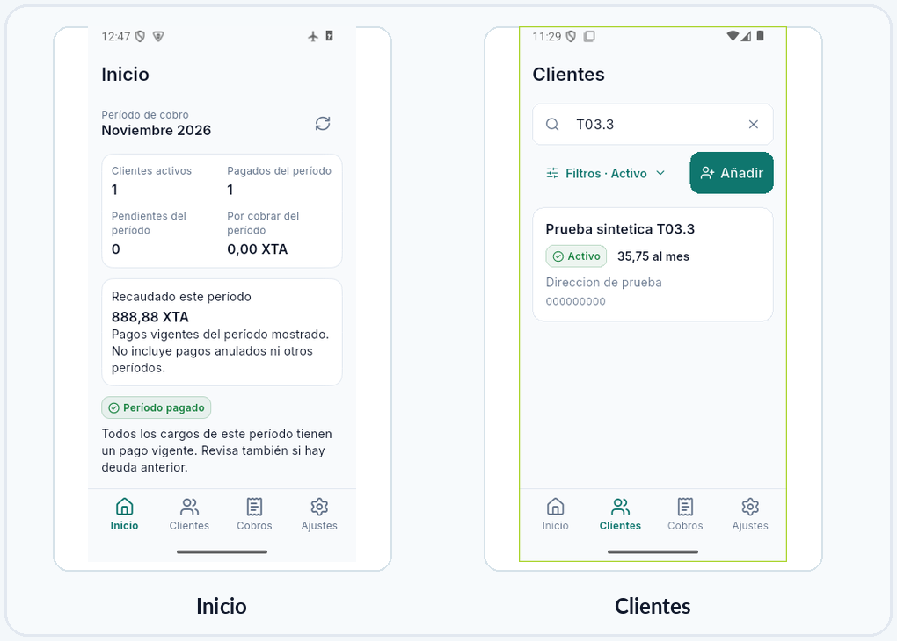
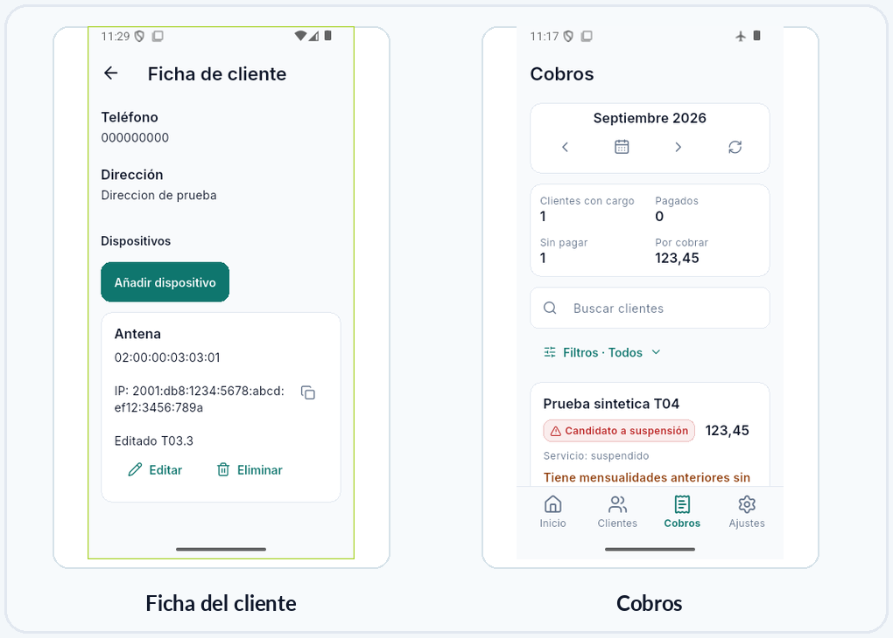
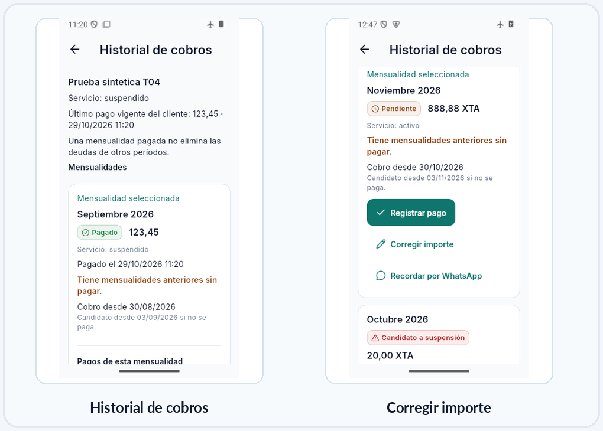
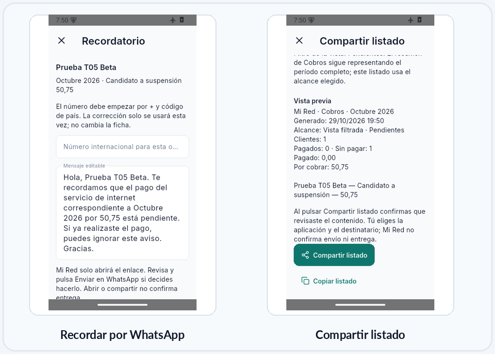
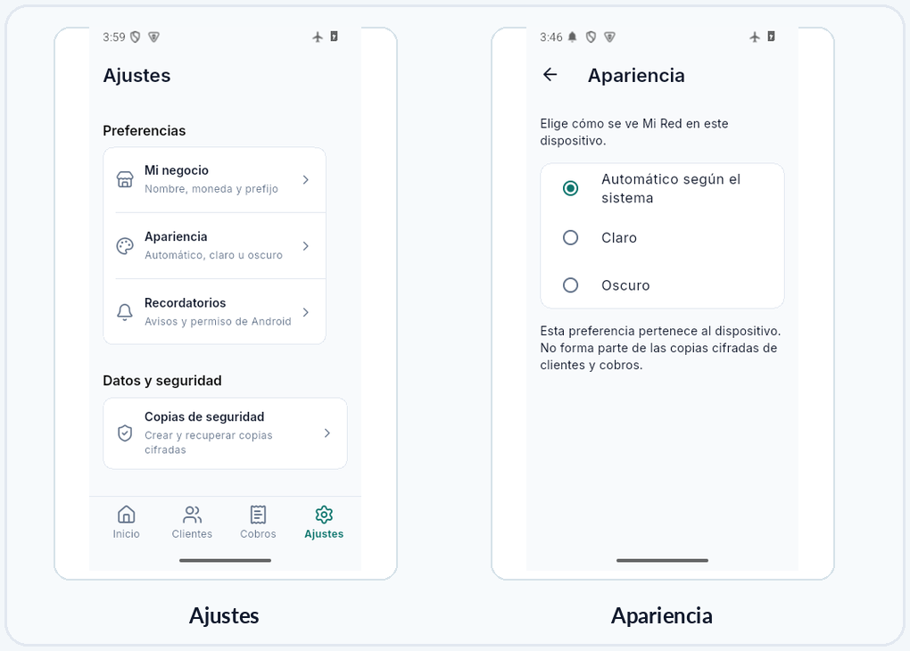
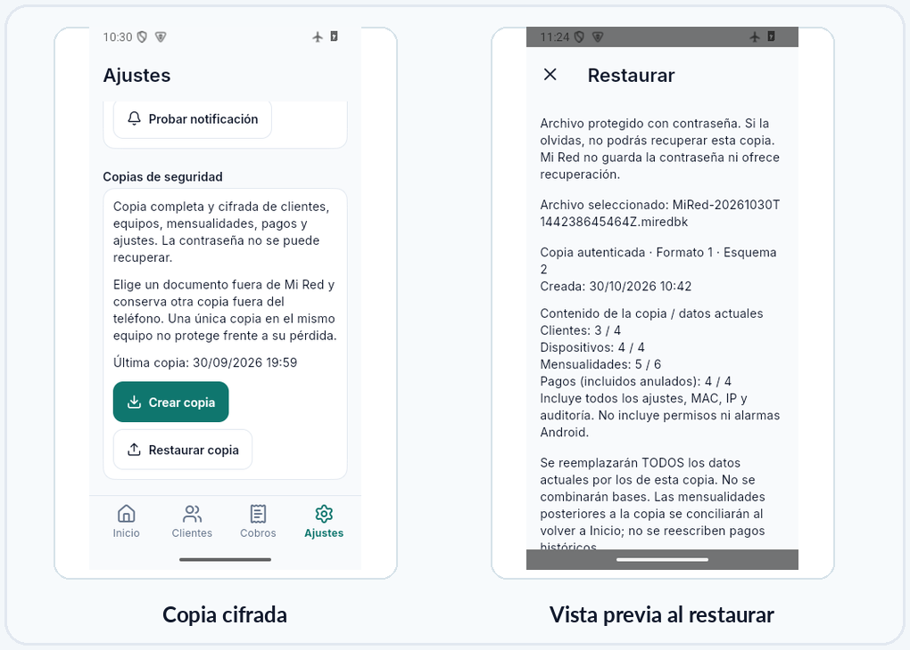

# Manual de usuario

**Mi Red 1.0 · Guía para administrar clientes y cobros desde Android**

Esta guía está dirigida a la persona que administra una pequeña red local. No hace falta saber programar ni tener conocimientos técnicos avanzados. Los ejemplos de las capturas usan **datos ficticios**.

> **Lo más importante:** Mi Red guarda los datos en el teléfono. Haz copias de seguridad cifradas con frecuencia y conserva la contraseña y otra copia del archivo fuera del móvil.

## 1. ¿Qué puedes hacer con Mi Red?

Mi Red sirve para registrar clientes de una red local, guardar información de sus equipos y llevar el control mensual de cobros. La gestión principal funciona **sin conexión a internet**.

En la parte inferior aparecen cuatro secciones:

| Sección | Para qué sirve |
|---|---|
| **Inicio** | Ver cifras del período, dinero recaudado, pendientes y clientes por revisar. |
| **Clientes** | Crear y buscar clientes; editar datos y administrar sus dispositivos. |
| **Cobros** | Consultar mensualidades, registrar pagos, corregir cargos permitidos y ver historial. |
| **Ajustes** | Configurar el negocio, apariencia, avisos, respaldos e información de la app. |

## 2. Preparar la aplicación por primera vez

1. Instala el **APK de Mi Red** que te haya entregado el responsable del proyecto o desde una fuente confiable.
2. Si Android lo solicita, autoriza la instalación para esa aplicación de archivos. No hace falta desactivar permanentemente la seguridad del teléfono.
3. Abre **Mi Red**. No pide crear una cuenta ni iniciar sesión.
4. Abre **Ajustes → Mi negocio** y configura el nombre de tu negocio, la etiqueta de moneda y, si lo necesitas, un prefijo telefónico informativo.
5. En **Ajustes → Recordatorios**, decide si quieres activar los avisos. Android puede pedir permiso para mostrar notificaciones.
6. En **Ajustes → Apariencia**, elige Automático, Claro u Oscuro.
7. Empieza a registrar clientes. Después de ingresar información importante, crea tu primera copia de seguridad.

**Moneda:** elegir «CUP», «USD» u otra etiqueta **no convierte** los importes. Solo cambia cómo se muestran. Asegúrate de registrar las cantidades en la moneda que realmente cobras.

**Prefijo telefónico:** es una referencia para ti. Mi Red no añade automáticamente un código de país a números ambiguos al abrir WhatsApp.

## 3. Entender la pantalla Inicio

En **Inicio** verás el período de cobro vigente y sus indicadores:

- **Clientes activos:** personas cuyo servicio está marcado como activo; no significa que hayan pagado.
- **Pagados del período:** mensualidades del período con un pago válido.
- **Pendientes del período:** mensualidades sin pago válido, incluidas las ya vencidas.
- **Por cobrar del período:** importe pendiente **solo** del período mostrado, no toda la deuda histórica.
- **Recaudado este período:** importe recibido en pagos válidos del período; los pagos anulados no cuentan.
- **Requieren revisión:** clientes activos con algún cargo que ya cumple las condiciones para posible suspensión, incluso si es de un mes anterior.

Desde aquí puedes usar **Añadir cliente**, **Ver cobros** y **Ver pendientes**. Toca **Actualizar** para refrescar la información.

> **Importante:** un cliente puede tener pagado el mes actual y aún deber meses anteriores. La aplicación muestra ambas situaciones por separado.

## 4. Registrar y administrar clientes

### Añadir un cliente

1. Ve a **Clientes → Añadir** (o **Inicio → Añadir cliente**).
2. Escribe el **nombre completo** y la **mensualidad**. Son los datos necesarios para crear el cliente.
3. Añade teléfono, dirección y notas si dispones de ellos.
4. Selecciona el **estado del servicio** y guarda.

Cada cliente puede tener una mensualidad distinta. La aplicación guarda los importes de los cargos ya generados: **cambiar la tarifa de un cliente no modifica las mensualidades anteriores**.

### Buscar, editar y filtrar

- En **Clientes**, escribe parte del nombre, teléfono o dirección en el buscador.
- Abre **Filtros** para ver Activos, Suspendidos, Archivados o Todos.
- Toca una ficha para consultar datos y dispositivos; desde ella puedes editar información.
- Para dejar de generar nuevos cargos a alguien que se retira, utiliza **Archivar**. Puedes volver a activar el cliente después.

**Archivar no elimina el historial**: sus cargos y pagos siguen registrados. Un servicio «Suspendido» es un estado que cambia el administrador; no se cambia automáticamente al detectarse una deuda.

## 5. Guardar los dispositivos del cliente

Dentro de la **Ficha del cliente**, ve a **Dispositivos → Añadir dispositivo**.

Puedes registrar una antena, ONT, router u otro equipo, según las opciones disponibles. Cada dispositivo puede incluir:

- **Dirección MAC** (opcional). Ejemplo: `02:00:00:03:03:01`.
- **Dirección IP** (opcional). Admite IPv4, por ejemplo `192.0.2.20`, e IPv6, por ejemplo `2001:db8::20`.
- **Notas** para identificar la instalación.

Es posible guardar varios dispositivos por cliente. Puedes editar o eliminar un dispositivo y **copiar la IP** desde su ficha.

> Mi Red **no se conecta al router**, no detecta dispositivos, no cambia IP/MAC y no corta internet. Estos campos son un registro de consulta.

## 6. Cómo funcionan las mensualidades

Todos los clientes utilizan un ciclo común de cobro:

- **Día 30 del mes anterior:** se abre el período del siguiente mes. Si el mes no tiene día 30, se usa su último día.
- **Días 1 y 2 del período:** un cargo que aún no tiene pago aparece pendiente.
- **Desde el día 3:** si sigue sin pago válido, aparece como **Candidato a suspensión**.

**Ejemplo:** la mensualidad de **noviembre** se abre el **30 de octubre**. Si continúa impagada, el **3 de noviembre** se marca como candidata a suspensión.

La etiqueta **Candidato a suspensión** es una ayuda para revisar el caso. **No suspende el servicio por sí sola.** La condición real «Activo» o «Suspendido» se administra por separado.

Al abrir o reanudar Mi Red, se comprueban los períodos que correspondan y se evita generar el mismo cargo dos veces.

### Consultar Cobros

1. Entra a **Cobros**.
2. Cambia el mes con las flechas o el selector del período.
3. Usa la búsqueda y los filtros para localizar una mensualidad.
4. Toca el cliente o **Ver historial** para revisar períodos anteriores, deudas y pagos.

El resumen superior corresponde a **todo el período**; los filtros modifican las filas visibles, no las cifras generales.

## 7. Registrar un pago o corregir un error

### Registrar pago completo

1. En **Cobros** o en **Historial de cobros**, localiza la mensualidad pendiente.
2. Pulsa **Registrar pago**.
3. Revisa **cliente, período e importe** en la confirmación.
4. Si te sirve, escribe una nota opcional y pulsa **Confirmar pago**.
5. Comprueba que aparece **Pagado** y que se actualizan las cifras en Inicio.

Mi Red registra **pagos completos**. No admite abonos parciales ni pagos electrónicos dentro de la aplicación.

### Anular un pago por error

1. Abre **Historial de cobros** del cliente.
2. Busca el pago vigente y pulsa **Anular pago**.
3. Lee la advertencia y confirma solo si corresponde.

El pago queda registrado como **anulado**, con su información histórica; la mensualidad vuelve a pendiente o candidata según su fecha. No se borran las deudas de otros períodos.

### Corregir el importe de una mensualidad

En el historial, si el **cargo del período vigente está impagado**, verás **Corregir importe**. Indica el nuevo valor, revisa el importe anterior y el nuevo, y confirma. Solo cambia ese cargo; **no cambia la tarifa futura del cliente** ni otras mensualidades. No hay una bitácora detallada del valor anterior a cada corrección, por lo que debes confirmar con cuidado.

## 8. Enviar recordatorios por WhatsApp y compartir listados

### Recordar un cobro a un cliente

1. Abre la **mensualidad impagada** en el historial.
2. Elige **Recordar por WhatsApp**.
3. Revisa el teléfono. Debe estar en formato internacional, por ejemplo `+53...`, con el código de país y el número completo.
4. Edita el mensaje si es necesario.
5. Pulsa la acción para **abrir WhatsApp**. **Tú decides si envías el mensaje** en la aplicación externa.

Si no puedes abrir WhatsApp, puedes copiar o compartir el texto. Abrir el enlace **no confirma que el mensaje fue enviado o recibido**.

### Compartir un listado de Cobros

1. En **Cobros**, abre **Compartir listado**.
2. Elige **Período completo** o **Vista filtrada**.
3. Lee la vista previa: contiene nombres, estados e importes del alcance elegido.
4. Pulsa **Compartir listado** y selecciona la aplicación y destinatario en Android; también puedes copiarlo.

El listado no incluye de forma predeterminada teléfonos, direcciones, notas, MAC ni IP. Aun así, **los nombres y deudas son información privada**: revisa siempre el destinatario.

## 9. Recordatorios locales

En **Ajustes → Recordatorios** puedes activar o desactivar los avisos. Si Android solicita permiso, elige si deseas concederlo.

Mi Red prepara recordatorios locales para revisar **pendientes el día 2** y **posibles suspensiones el día 3**, alrededor de las **09:00**, hora local. Android o el ahorro de batería pueden entregarlos más tarde. No son una alarma garantizada al minuto.

- **Probar notificación** permite comprobar el permiso y el canal de avisos.
- Al tocar una notificación, se abre la vista correspondiente de Cobros/Pendientes.
- Los avisos **no generan pagos, no cambian cargos y no suspenden servicios**.
- Aunque no recibas notificación, abre Mi Red para revisar los pendientes actuales.

## 10. Ajustes y apariencia

**Ajustes** está dividido en pantallas independientes:

| Sección | Qué puedes cambiar o consultar |
|---|---|
| **Mi negocio** | Nombre, etiqueta de moneda y prefijo telefónico informativo. |
| **Apariencia** | Automático según el sistema, Claro u Oscuro. |
| **Recordatorios** | Activar avisos, consultar permisos y probar una notificación. |
| **Copias de seguridad** | Crear o restaurar copias protegidas con contraseña. |
| **Acerca de Mi Red** | Versión instalada, información básica y CoreX4Dev. |

La apariencia se guarda en **ese dispositivo**. No forma parte del archivo cifrado de clientes y cobros. Si restauras en otro teléfono, podrás elegir el tema nuevamente.

## 11. Crear una copia de seguridad (muy importante)

Cada copia protege los datos de **clientes, dispositivos, cargos, pagos y ajustes**. El archivo termina en **`.miredbk`** y está protegido con contraseña mediante cifrado.

1. Entra a **Ajustes → Copias de seguridad → Crear copia**.
2. Escribe una contraseña de **al menos 12 caracteres** y repítela.
3. Pulsa **Cifrar y elegir destino**.
4. En el selector de archivos Android, elige una ubicación accesible, por ejemplo **Descargas** o **Documentos**, y guarda.
5. Espera el mensaje de confirmación y comprueba que el archivo `.miredbk` existe.
6. Conserva **otra copia fuera del teléfono** y guarda la contraseña por separado.

> **ATENCIÓN:** si olvidas la contraseña, Mi Red **no puede recuperarla**. Una copia guardada solamente en el mismo teléfono no te protege si lo pierdes o se daña.

**Cuándo respaldar:** al finalizar una jornada con cambios importantes, antes de actualizar o cambiar de teléfono y periódicamente aunque no hayas tenido problemas.

## 12. Restaurar una copia o cambiar de teléfono

**Restaurar reemplaza todos los datos actuales. No los combina con los del archivo.**

1. Ten el archivo `.miredbk` y su contraseña disponibles.
2. Ve a **Ajustes → Copias de seguridad → Restaurar copia**.
3. Selecciona el archivo en el explorador Android.
4. Introduce la contraseña y pulsa **Comprobar copia**.
5. Revisa la **fecha y cantidad de clientes, dispositivos, mensualidades y pagos** que contiene la copia frente a los actuales.
6. Si todo es correcto, marca la aceptación del reemplazo y pulsa **Reemplazar datos**.
7. Espera el mensaje de éxito; vuelve a Inicio y revisa Clientes, Cobros y Recordatorios.

Si la contraseña es incorrecta o el archivo está dañado, Mi Red rechaza la copia **sin reemplazar los datos existentes**.

### Al cambiar de teléfono

Crea una copia, transfiere el archivo a un lugar seguro accesible desde el nuevo Android, instala la versión compatible de Mi Red, restaura y comprueba los datos. Puede ser necesario conceder nuevamente los permisos de notificaciones; el tema visual del teléfono nuevo es independiente del respaldo.

Si el archivo restaurado es antiguo, al volver a Inicio la aplicación puede crear las mensualidades faltantes que correspondan a los períodos posteriores. **No reescribe pagos históricos.**

## 13. Actualizar Mi Red sin perder datos

Antes de actualizar, **crea una copia cifrada y verifica que está guardada**.

Para una actualización normal, instala encima una versión nueva del **mismo desarrollador y firma**. No desinstales la aplicación: hacerlo normalmente elimina la base de datos privada. Si Android no acepta la actualización por conflicto de firma, **no fuerces la eliminación** sin comprobar primero tu respaldo externo y la contraseña.

Las actualizaciones deben provenir de una fuente confiable. El archivo APK por sí solo no es una copia de tus clientes ni de tus pagos.

## 14. Preguntas frecuentes y soluciones

**¿Por qué un cliente está «Candidato a suspensión» si tiene el servicio activo?**  
Porque son dos datos distintos: deuda pendiente y estado manual del servicio. Mi Red no desconecta equipos.

**¿Por qué pagó este mes pero sigue apareciendo una deuda?**  
Puede tener mensualidades de períodos anteriores sin pagar. Entra en **Historial de cobros**.

**¿Puedo registrar medio pago?**  
No. Esta versión solo registra pagos completos por mensualidad.

**¿Cambiar la tarifa modifica cargos ya generados?**  
No. Solo afecta cargos posteriores. Para un cargo vigente impagado puedes usar **Corregir importe**.

**¿Cambiar «CUP» por «USD» convierte el dinero?**  
No. Solo cambia la etiqueta; verifica que los importes correspondan a la moneda que usas.

**¿Por qué no llega el recordatorio a una hora exacta?**  
Android puede retrasarlo. Revisa permisos, batería y el interruptor de Recordatorios; consulta la app directamente si tienes dudas.

**¿Por qué WhatsApp no abre el contacto?**  
Revisa que el número tenga `+` y código de país completo, que exista una aplicación compatible y que tengas conexión para enviar.

**¿Dónde están mis datos?**  
En el almacenamiento local de Mi Red en el teléfono. Solo una copia externa y su contraseña permiten recuperarlos tras pérdida o desinstalación.

**¿Qué hago si no puedo instalar o abrir el APK?**  
Verifica que provenga de una fuente confiable, que tu Android sea compatible y que haya espacio disponible. Informa al responsable de la distribución de la marca, modelo, versión de Android y mensaje de error. **No compartas tu contraseña de respaldo.**

**¿Se puede borrar definitivamente un cliente?**  
La opción segura disponible es **Archivar**, que conserva el historial. El borrado permanente no forma parte del flujo habitual de la versión 1.0.

## 15. Reglas básicas para trabajar con seguridad

- Comprueba el **cliente, mes e importe** antes de confirmar pagos o correcciones.
- No confundas **candidato a suspensión** con **servicio suspendido**.
- Revisa nombres e importes antes de compartir listados con terceros.
- Crea respaldos y conserva **una segunda copia en otro lugar**.
- No reveles la contraseña ni envíes datos privados por canales inseguros.
- Antes de actualizar, reinstalar o cambiar de móvil, verifica el respaldo.

## Ayuda y créditos

**Mi Red 1.0** · Gestión de clientes y cobros para pequeñas redes locales.  
Desarrollado por **CoreX4Dev** · <https://corex4dev.com>

La gestión de clientes y cobros funciona offline. Los enlaces externos, WhatsApp y determinadas ubicaciones de almacenamiento pueden necesitar conexión. Mi Red no sustituye la revisión manual de cuentas ni realiza cortes de servicio de red.
